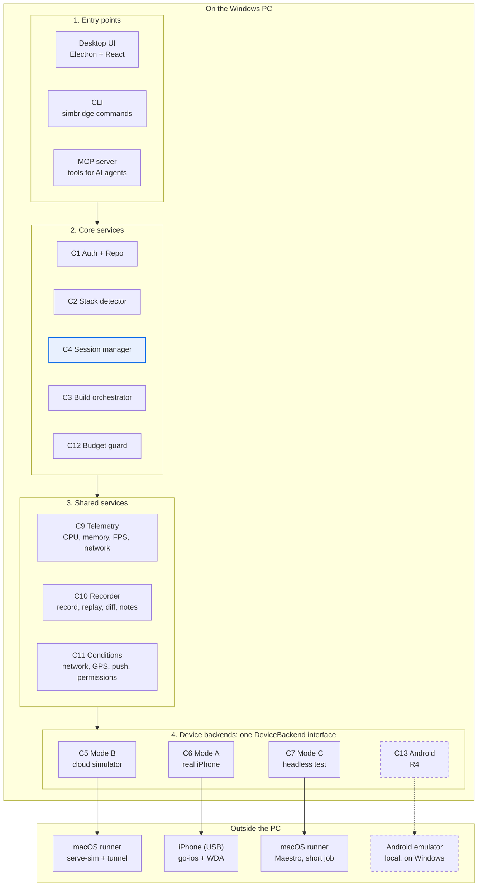
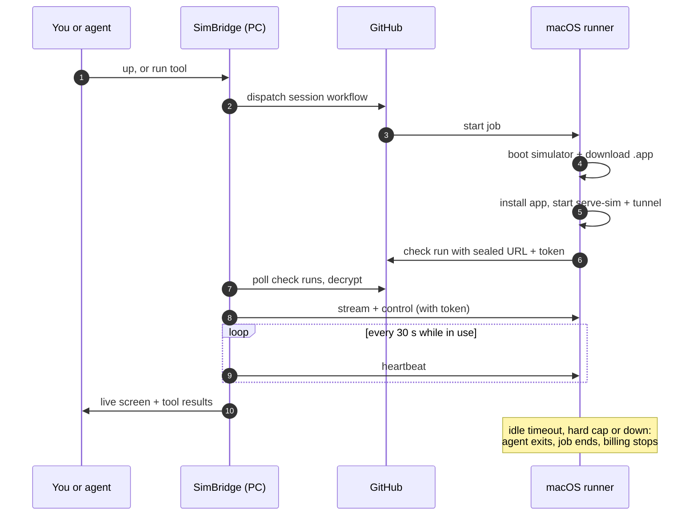

# SDS: iOS Agent Build Tool

Version 1.1 · 14 November 2026 · Author: Furqan

## 1. Introduction

This SDS turns the [SRS](SRS.md) into a buildable design: one Windows client with a pluggable "device backend" per run mode, three GitHub Actions jobs, and an MCP server that exposes the same tools whatever runs the app.

### 1.1 Purpose and scope

It defines SimBridge's architecture, components, data, interfaces, workflows, security and test strategy for releases R0 to R4. Requirement IDs (FR-, NFR-) refer to the SRS.

### 1.2 Design goals

1.  **Spend runner minutes only on value:** never compile what has not changed; never keep an idle Mac alive.

2.  **One tool surface:** humans and agents use the same commands; every mode answers the same tools.

3.  **Plug-in backends:** cloud simulator, real iPhone, headless runner, and later Android or a self-hosted Mac, all behind one interface.

4.  **Safe by default:** no inbound ports, no secrets on disk, no redistribution of Apple software.

5.  **Explainable failures:** every error carries a cause and a next step a beginner or an agent can act on.

### 1.3 Design decisions at a glance

| Decision             | Choice                                                                                    | Why                                                                                                  |
|----------------------|-------------------------------------------------------------------------------------------|------------------------------------------------------------------------------------------------------|
| Client technology    | Electron + TypeScript (React UI), Node core                                               | One language for UI, CLI and MCP server; Node packages exist for GitHub, MCP and tunnels             |
| Device control on PC | go-ios binary called by the client                                                        | Works on Windows and Linux; JSON output; runs WebDriverAgent                                         |
| Simulator on runner  | serve-sim                                                                                 | Streams and controls the simulator; already agent-friendly                                           |
| Runner-to-PC link    | Cloudflare quick tunnel, behind a TunnelProvider interface (Tailscale can be added later) | Outbound only; no account needed. Quick tunnels lack SSE, so live streams use WebSockets             |
| Rebuild decision     | Content fingerprint of native inputs                                                      | Turns most JS-only changes into 0-minute runs                                                        |
| Local storage        | SQLite + files in the app data folder                                                     | Simple, single-user, no server needed                                                                |
| Test runner          | Maestro                                                                                   | YAML flows agents can write; records to flows                                                        |
| GitHub sign-in       | GitHub App with device flow                                                               | Per-repo access, fine-grained permissions and expiring tokens, unlike an OAuth App's all-repos scope |
| Live streams         | WebSockets (logs, stats, control)                                                         | Work through Cloudflare quick tunnels, which do not support Server-Sent Events                       |

## 2. Architecture overview

SimBridge is a layered client: entry points call core services, core and shared services call device backends, and each backend drives one outside target. The Session Manager is the hub that picks the backend.



*Figure 2.1: Component architecture. Every run mode plugs into one interface, so agents never change.*

Arrows mean "calls". The Build Orchestrator also calls GitHub directly to dispatch build jobs and read artifacts; the Budget Guard reads GitHub usage. The dashed Android path is a later release.

## 3. Component design

The client has 13 components; four of them (C5, C6, C7, and C13 for Android) are device backends that implement one shared interface, `DeviceBackend`. The rest never know which backend is active.

### 3.1 C1 Auth and Repo Manager

- **Responsibility:** GitHub sign-in, repo list, linking a repo, installing workflow files by pull request.

- **Interfaces:** `signIn()`, `listRepos(query)`, `linkRepo(owner, name)`, `installWorkflows(repo)` returns PR URL.

- **Technology:** Octokit (GitHub REST/GraphQL); GitHub App device flow; tokens in Windows Credential Manager via keytar.

- **SRS:** FR-SET-01 to 07.

GitHub App permissions requested (repository level, only on repos the user selects at install):

| Permission    | Access         | Used for                                                      |
|---------------|----------------|---------------------------------------------------------------|
| Actions       | Read and write | Dispatch workflows, read runs, download artifacts, read usage |
| Checks        | Read           | Pick up the encrypted session check run                       |
| Contents      | Read and write | Read the repo for stack detection; branch for the workflow PR |
| Pull requests | Read and write | Open the workflow pull request                                |
| Workflows     | Read and write | Add and update files under .github/workflows                  |
| Secrets       | Read and write | Store signing material and the ASC key (R2)                   |
| Metadata      | Read           | Required by GitHub for every app                              |

The app uses the device flow (the user enters a code on github.com), so no client secret is shipped in SimBridge. User tokens expire and are refreshed automatically.

### 3.2 C2 Stack Detector

- **Responsibility:** read the repo tree and decide Flutter, React Native or Expo, package manager and build commands.

- **Interfaces:** `detect(repo)` returns `StackProfile { kind, packageManager, iosDir, buildCmd, simBuildCmd, deviceBuildCmd, warnings[] }`.

- **Rules:** pubspec.yaml means Flutter; package.json with `expo` means Expo; with `react-native` and no expo means bare React Native. User override wins.

- **SRS:** FR-STK-01 to 05.

### 3.3 C3 Build Orchestrator

- **Responsibility:** fingerprint, decide reuse or build, dispatch the build workflow, follow its logs, record the result.

- **Fingerprint:** SHA-256 over sorted contents of: lock files (Podfile.lock, pubspec.lock, package lock), the ios folder minus build output, native dependency versions, the stack profile and the runner's Xcode version.

- **Interfaces:** `build({force})` returns `BuildResult { fingerprint, reused, simAppArtifactId, ipaArtifactId?, durationSec, minutes }`.

- **Error summariser:** maps known failure patterns (CocoaPods mismatch, signing errors, missing bundle ID, Xcode version) to cause + fix text.

- **SRS:** FR-BLD-01 to 09.

### 3.4 C4 Session Manager

- **Responsibility:** choose the mode, start or rejoin a session through the right backend, send heartbeats, end sessions, keep one live session per repo.

- **States:** Idle, Starting, Live, Reconnecting, Ending, Ended, Failed.

- **Interfaces:** `up({mode})`, `down()`, `status()`, events `onState`, `onFrame`, `onLog`.

- **Mode choice:** user or agent override, else iPhone present gives Mode A, else Mode B; budget guard may suggest A or C.

- **SRS:** FR-MOD-01 to 04, FR-SIM-05, 08, 11.

### 3.5 C5 Cloud Simulator Backend (Mode B)

- **Responsibility:** dispatch the session workflow, wait for the runner to post its tunnel URL, then proxy stream and control.

- **Runner side:** a session agent script (Node) that boots the simulator, installs the .app, starts serve-sim, starts the tunnel, checks the token on every request, and runs the idle watchdog.

- **Hand-off of the URL:** the runner encrypts the URL and token with the client's one-time public key and posts them as the summary of a check run named for the session; the client polls the check runs until it appears (job outputs are only readable after a job ends, so they cannot be used).

- **SRS:** FR-SIM-01 to 15.

#### Tunnel providers

The runner-to-PC link sits behind one interface, so a new tunnel never touches the rest of SimBridge (FR-SIM-12).

```ts
interface TunnelProvider {
  kind: 'cloudflare-quick' | 'tailscale' | 'cloudflare-named';
  // runner side: expose the session API, return how to reach it
  start(localPort: number): Promise<{ address: string }>;
  stop(): Promise<void>;
  // client side: check the PC is ready (for example, Tailscale app running)
  checkClient(): Promise<{ ready: boolean; fix?: string }>;
}
```

| Provider                | Status                     | Needs                                                       | Notes                                                                                   |
|-------------------------|----------------------------|-------------------------------------------------------------|-----------------------------------------------------------------------------------------|
| Cloudflare quick tunnel | R1 (only provider for now) | Nothing; cloudflared on the runner                          | Random trycloudflare.com URL; up to 200 requests in flight; no SSE; no uptime guarantee |
| Tailscale               | Later (Could, FR-SIM-15)   | Free Tailscale account, app on the PC, key as GitHub secret | Private network, often a direct connection; offered if quick tunnels prove unreliable   |
| Cloudflare named tunnel | Later (Could)              | User's own Cloudflare account and domain                    | Fixed address, no quick-tunnel limits                                                   |

Whatever the provider, the address still travels encrypted in the check run, every request still needs the session token, and the runner still ends itself.

### 3.6 C6 Real Device Backend (Mode A)

- **Responsibility:** install the .ipa, start WebDriverAgent, stream the screen, collect device stats.

- **Technology:** go-ios (`install`, `runwda`, `screenshot --stream`, `tunnel start`, instruments for CPU and memory, `devicestate` for network conditions).

- **SRS:** FR-DEV-01 to 07, FR-CND-01.

### 3.7 C7 Headless Runner Backend (Mode C)

- **Responsibility:** dispatch the headless workflow with a Maestro flow, collect the result artifact, report pass or fail.

- **SRS:** FR-HLT-01 to 05.

### 3.8 C8 MCP Server

- **Responsibility:** expose all tools to agents; validate inputs; enforce approval for risky tools; return the standard JSON envelope.

- **Technology:** official MCP TypeScript SDK; stdio transport; optional localhost HTTP.

- **SRS:** FR-AGT-01 to 11.

### 3.9 C9 Telemetry Collector

- **Responsibility:** gather CPU, memory, FPS, network, logs and crashes from the active backend into one time series.

- **Sources:** Mode B: simctl log stream, crash reports, process stats over the session agent; Mode A: go-ios instruments and syslog; React Native and Flutter debug hooks for network and frames where available.

- **Alerts:** rules like `memoryMB > 500 for 10s` raise alerts (FR-STA-07).

- **SRS:** FR-STA-01 to 07.

### 3.10 C10 Recorder and Replayer

- **Responsibility:** record actions with timestamps, screenshots and stats; replay on any backend; export Maestro flows; build bug bundles; visual diff; annotations.

- **Replay:** actions are stored by accessibility label when one exists, falling back to normalised coordinates (0 to 1) so they work on any screen size.

- **Visual diff:** per step, a perceptual diff of screenshots between two builds; changed regions over a threshold are highlighted.

- **Annotations:** the step list plus screenshots is sent to the connected agent, which returns one sentence per step.

- **SRS:** FR-RPL-01 to 09.

### 3.11 C11 Conditions Controller

C11 owns one `ConditionState` per session and applies changes to it through the active backend. It is compulsory (FR-CND, Must): location, push and permissions on the simulator ship in R1; network shaping and real-iPhone support in R2.

- **Responsibility:** network profiles, location and routes, push notifications, permissions and permission prompts, saved scenarios, and a clean reset at session end.

- **SRS:** FR-CND-01 to 23.

#### How each condition is applied

| Condition                   | Cloud simulator (Mode B, on the runner)                                                          | Real iPhone (Mode A, from the PC)                              | Android emulator (R4, on the PC)                     |
|-----------------------------|--------------------------------------------------------------------------------------------------|----------------------------------------------------------------|------------------------------------------------------|
| Network profile             | macOS dummynet shaping (dnctl + pfctl) by the session agent, excluding tunnel and GitHub traffic | go-ios devicestate (iOS built-in network conditioning)         | Emulator console: network speed and network delay    |
| Offline                     | Dummynet rule with 100% loss, auto-lifted by the watchdog                                        | go-ios 100% loss profile                                       | adb: svc wifi disable and svc data disable           |
| Fixed location              | xcrun simctl location set lat,lon                                                                | go-ios setlocation                                             | adb emu geo fix                                      |
| Route (GPX)                 | xcrun simctl location start with waypoints and speed                                             | go-ios setlocationgpx                                          | geo fix points sent at the chosen speed              |
| Push notification           | xcrun simctl push with the payload file                                                          | APNs sandbox, HTTP/2, sent from the PC with the user's .p8 key | FCM HTTP v1 with the user's Firebase service account |
| Grant, revoke, reset access | xcrun simctl privacy grant, revoke or reset                                                      | Not possible on iOS devices; reset by reinstalling the app     | adb shell pm grant or pm revoke                      |
| Permission prompts          | Tap Allow or Don't Allow found in the accessibility tree                                         | WebDriverAgent alert accept or dismiss                         | UI Automator tap on the dialog button                |

#### Network profiles (defaults, editable)

| Profile          | Down     | Up       | Added latency | Loss |
|------------------|----------|----------|---------------|------|
| Edge             | 240 kbps | 200 kbps | 400 ms        | 0%   |
| 3G               | 780 kbps | 330 kbps | 100 ms        | 0%   |
| LTE              | 50 Mbps  | 10 Mbps  | 50 ms         | 0%   |
| Very bad network | 1 Mbps   | 1 Mbps   | 500 ms        | 10%  |
| Offline          | 0        | 0        | none          | 100% |

The defaults are modelled on Apple's Network Link Conditioner presets; real-iPhone runs use the device's own profile closest to the one chosen.

#### Network shaping on the runner (design and risk)

- The session agent runs with passwordless sudo (standard on GitHub macOS runners), creates a dummynet pipe with the profile's bandwidth, delay and loss, and loads pf rules into its own anchor (simbridge) so the system rules are untouched.

- Traffic that must never be shaped is passed first: the tunnel (cloudflared, port 7844, or Tailscale's UDP port) and GitHub's Actions address ranges (fetched from GitHub's meta API at session start). Without this, Offline would cut the stream and could make the runner lose its job.

- **Risk:** the simulator shares the runner's network stack, so these exclusions are the only separation. The R0/R2 spike must prove the stream stays smooth under every profile. **Fallback:** a throttling HTTP(S) proxy set as the macOS system proxy, which shapes app traffic only (apps that ignore the system proxy are not shaped; the UI says so).

- Reset: flush the anchor and the pipes at session end, and whenever the watchdog ends the job.

#### State, scenarios and recording

```ts
interface ConditionState {
  network: { profile: 'none' | 'offline' | 'edge' | '3g' | 'lte' | 'very-bad' | 'custom';
             downKbps?: number; upKbps?: number; latencyMs?: number; lossPct?: number };
  location: { kind: 'default' } | { kind: 'fixed'; lat: number; lon: number; label?: string }
          | { kind: 'route'; points: [number, number][]; speedKmh: number };
  permissions: Record<Service, 'granted' | 'denied' | 'unset'>;
  promptPolicy: 'allow' | 'deny' | 'ask';
}
```

- C11 applies only the difference between the old and new state, one change at a time, and confirms each within 3 seconds (FR-CND-22); a failure rolls back that change and returns the reason.

- A scenario is a saved `ConditionState` with a name, stored per repo (table `scenarios`, section 5.1).

- While recording, every change is written as a step: `{"action": "condition", "condition": {"network": "3g"}}`; replay re-applies it at the same point (FR-CND-20).

- Push payloads are checked before sending: valid JSON, an `aps` object, size at most 4 KB (FR-CND-11). The APNs key and Firebase credentials stay in the Windows Credential Manager and are used only from the PC.

#### MCP tools

| Tool              | Inputs                                                 | Returns                             |
|-------------------|--------------------------------------------------------|-------------------------------------|
| set_network       | profile, or custom down, up, latency, loss             | ConditionState                      |
| set_location      | lat, lon, or a saved place name                        | ConditionState                      |
| play_route        | GPX text or points, speed (km/h or walk, cycle, drive) | ConditionState + estimated duration |
| clear_location    | none                                                   | ConditionState                      |
| send_push         | payload JSON or template name                          | delivered: bool, reason             |
| set_permission    | service, grant, revoke or reset                        | ConditionState                      |
| set_prompt_policy | allow, deny or ask                                     | ConditionState                      |
| apply_scenario    | scenario name                                          | ConditionState                      |
| reset_conditions  | none                                                   | ConditionState (all defaults)       |

### 3.12 C12 Budget Guard

- **Responsibility:** read Actions usage, keep a local ledger of minutes per repo and month, warn and block at thresholds.

- **SRS:** FR-BUD-01 to 05, FR-UI-06.

### 3.13 The DeviceBackend interface

```ts
interface DeviceBackend {
  kind: 'cloud-sim' | 'device' | 'headless' | 'android';
  start(build: BuildResult, opts: StartOptions): Promise<SessionInfo>;
  stop(): Promise<void>;
  screenshot(): Promise<Buffer>;
  stream(): AsyncIterable<Frame>;
  tap(t: Target): Promise<void>;   // Target = {label} or {x, y} in 0..1
  swipe(from: Target, to: Target, ms?: number): Promise<void>;
  typeText(text: string): Promise<void>;
  pressButton(name: Button): Promise<void>;
  accessibilityTree(): Promise<A11yNode>;
  logs(): AsyncIterable<LogLine>;
  stats(): AsyncIterable<StatSample>;
  setCondition(c: Condition): Promise<void>;
}
```

Android support (FR-AND, R4) is a fourth implementation of this interface, designed in C13 below; no other component changes.

### 3.14 C13 Android Backend (R4, if time allows)

C13 brings Android to SimBridge by running Google's own tools on the Windows PC: no runner, no tunnel, no signing account for debug builds, so it costs no GitHub minutes. It has three parts: the Android Setup Manager, the Android Build Runner and the Emulator Backend.

- **SRS:** FR-AND-01 to 17, plus the Android column of FR-CND.

#### Android Setup Manager

- **PC check:** reads whether CPU virtualization is on and whether Windows Hypervisor Platform (or the Android Emulator hypervisor driver) is installed, plus free RAM and disk. Each gap gets a plain-words fix (for example, "turn on virtualization in BIOS").

- **SDK:** looks for an SDK at ANDROID_HOME or the default %LOCALAPPDATA%\Android\Sdk. If none, downloads Google's command-line tools and runs sdkmanager for platform-tools (adb), emulator, a platform and one x86_64 system image with Google Play services (needed for push through FCM). Google's licence prompts are shown to the user, never auto-accepted silently.

- **Java:** Gradle needs a JDK; the manager finds one or installs a supported version.

- **Emulators:** avdmanager creates AVDs from presets (phone, small phone, tablet) and an Android version; SimBridge names them `simbridge-<preset>-<api>`.

#### Android Build Runner

| Stack        | Command                                                  | Output                                            |
|--------------|----------------------------------------------------------|---------------------------------------------------|
| Flutter      | flutter build apk --debug                                | build/app/outputs/flutter-apk/app-debug.apk       |
| React Native | android\gradlew.bat assembleDebug                        | android/app/build/outputs/apk/debug/app-debug.apk |
| Expo         | npx expo prebuild -p android, then gradlew assembleDebug | same as React Native                              |

- **Fingerprint:** android folder (minus build output), gradle files and wrapper version, lock files, native dependency versions. A match reuses the last APK (FR-AND-05).

- **Cache:** Gradle's own cache on the PC; nothing to upload.

- **Optional cloud build:** simbridge-android-build.yml on ubuntu-latest (1x minutes) for slow PCs; the APK comes back as artifact `simbridge-apk-<fingerprint12>` (FR-AND-06).

#### Emulator Backend (implements DeviceBackend)

| DeviceBackend method | Android implementation                                                                                                                                            |
|----------------------|-------------------------------------------------------------------------------------------------------------------------------------------------------------------|
| start                | emulator -avd `<name>` (add -no-window for headless); adb wait-for-device; wait until sys.boot_completed is 1; adb install -r app-debug.apk; launch with am start |
| stream               | scrcpy server (open source, Apache 2.0) pushed to the device, H.264 over an adb forward, decoded in the client; fallback: adb exec-out screencap polling          |
| tap, swipe, typeText | scrcpy control channel for low lag; fallback: adb shell input tap, swipe, text                                                                                    |
| pressButton          | key events: Back, Home, Recents, volume, power                                                                                                                    |
| accessibilityTree    | adb shell uiautomator dump, parsed into A11yNode (text, content description, resource id, bounds)                                                                 |
| logs                 | adb logcat filtered by the app's process id; crash buffer for exceptions; "app not responding" from system logs                                                   |
| stats                | dumpsys meminfo (memory), per-process CPU from top, dumpsys gfxinfo (frames and janky frames), network bytes from the system's stats                              |
| setCondition         | see the Android column of C11                                                                                                                                     |
| stop                 | adb emu kill; conditions reset by a fresh boot                                                                                                                    |

- **Live reload:** adb reverse tcp:8081 tcp:8081 lets a React Native app reach Metro on the PC; Flutter runs flutter run against the emulator for hot reload.

- **Real phones:** the same backend works with a USB-connected Android phone once USB debugging is on; only boot and stop are skipped.

- **Replay and tests:** the recording format is unchanged (labels from UI Automator, coordinates 0 to 1); Maestro runs Android flows on the emulator directly.

#### Limits and risks

- The emulator needs several GB of free RAM; on 8 GB PCs SimBridge suggests closing the browser or using a USB phone.

- Other virtualization software can clash with the Windows hypervisor; the setup check detects and explains this.

- FCM push needs the user's own Firebase project; without it, push tests on Android are unavailable and the UI says so.

## 4. Key flows

The cloud simulator session is the most complex flow, so it is drawn; the other flows are straight runs of steps.

### 4.1 Mode B session



*Figure 4.1: Mode B session. Minutes are used only from job start to the idle stop.*

The runner never waits for the client: if heartbeats stop, step 11 still happens on its own, so a crashed PC cannot leave a Mac billing.

### 4.2 Build

1.  Client computes the fingerprint locally from the checked-out repo.

2.  Client looks up the fingerprint in the builds table, then confirms the artifact still exists on GitHub.

3.  Found: return the saved build (0 minutes). Not found: dispatch simbridge-build.yml with the fingerprint.

4.  Client follows the run's logs; the error summariser watches for known failures.

5.  On success, the client stores artifact ids against the fingerprint.

### 4.3 Mode A real iPhone

1.  Session Manager sees a trusted iPhone through go-ios and picks Mode A.

2.  Client downloads the .ipa artifact (build it first if needed, with device_build true).

3.  go-ios starts the iOS 17+ tunnel, installs the app, and runs WebDriverAgent.

4.  Client streams the screen (MJPEG) and sends input to WDA; telemetry reads go-ios instruments.

5.  For React Native, Metro runs on the PC and the app loads code from it over Wi-Fi.

### 4.4 Mode C headless test

1.  Agent calls run_test with a flow or a recording id (recordings are exported to a Maestro flow first).

2.  Client dispatches simbridge-test.yml with the flow and the build to test.

3.  Runner runs the flow, uploads the result artifact and exits.

4.  Client downloads result.json and returns pass or fail, the failing step and screenshot links.

### 4.5 Agent self-check loop

1.  Agent edits code.

2.  Agent calls build (usually reused) and run (rejoins the live session if any).

3.  Agent reads accessibility_tree, taps by label, takes screenshots.

4.  Agent reads logs, crashes and stats; alerts are included in tool results.

5.  Problem found: agent fixes and goes back to step 1. None found: agent reports success with screenshots, or calls run_test to lock the fix in as a test.

### 4.6 Session states

- Idle to Starting: up called.

- Starting to Live: check run found and the first frame received.

- Live to Reconnecting: tunnel error; back to Live within 60 seconds, else Failed.

- Live to Ending: down called, idle timeout, or hard cap.

- Ending to Ended: the job's run reports completed; minutes written to the ledger.

### 4.7 Device conditions

1.  User or agent asks for a change (panel, scenario, or MCP tool).

2.  C11 works out the difference from the current ConditionState.

3.  C11 sends each change to the active backend: the runner's session API (POST /condition) in Mode B, go-ios or APNs from the PC in Mode A, adb in Android.

4.  The backend confirms; C11 updates the state, the status strip and, if recording, writes a condition step.

5.  On session end, C11 calls reset on the backend; in Mode B the watchdog also flushes the network rules.

### 4.8 Android session (R4)

1.  User picks Android; the Setup Manager checks the PC and the SDK, fixing or explaining gaps.

2.  The Build Runner fingerprints the android folder; reuses the last APK or builds a debug APK locally.

3.  The Emulator Backend boots the AVD, installs and launches the app, and starts the scrcpy stream.

4.  Agents and the UI use the same tools; telemetry reads logcat and dumpsys.

5.  On stop, the emulator shuts down; no GitHub minutes were used.

### 4.9 Flutter hot reload on the runner (R3, timeboxed spike)

1.  The session job also checks out the same commit and restores a cached Flutter SDK.

2.  It installs the saved debug build and attaches the Flutter tool to the running app (flutter attach).

3.  When the user saves a .dart file, the client checks the commit still matches, then sends only the changed files to POST /sync.

4.  The runner writes them and triggers a hot reload (flutter run documents a pid file where SIGUSR1 means reload and SIGUSR2 means restart; the spike confirms the same works with attach).

5.  If reload fails: hot restart; if that fails: a normal rebuild (FR-SIM-10).

The spike decides go or no-go early in R3; React Native already has live reload through Metro from R2.

## 5. Data design

All data lives on the user's PC (SQLite plus files) or in the user's own GitHub repo (artifacts and secrets). SimBridge runs no server and keeps no user data elsewhere.

### 5.1 Local database (SQLite)

| Table           | Key columns                                                                                                                    | Purpose                                              |
|-----------------|--------------------------------------------------------------------------------------------------------------------------------|------------------------------------------------------|
| repos           | id, owner, name, stack_json, linked_at, workflow_version                                                                       | Linked repos and their detected stack                |
| builds          | id, repo_id, platform (ios, android), fingerprint, sim_artifact_id, ipa_artifact_id, status, started_at, duration_sec, minutes | Build history and reuse lookup                       |
| sessions        | id, repo_id, mode, build_id, run_id, state, started_at, ended_at, end_reason, minutes                                          | One row per run; end_reason = user, idle, cap, error |
| recordings      | id, session_id, name, created_at, steps_count, path                                                                            | Recording index                                      |
| stat_samples    | session_id, ts, cpu_pct, mem_mb, fps, net_kbps                                                                                 | Time series (also written to a file per session)     |
| alerts          | id, session_id, ts, rule, value                                                                                                | Performance alerts raised                            |
| budget_ledger   | repo_id, month, minutes_used, allowance, source                                                                                | Minute tracking per repo and month                   |
| settings        | key, value                                                                                                                     | Idle timeout, hard cap, thresholds, default mode     |
| scenarios       | id, repo_id, name, conditions_json, created_at                                                                                 | Saved device-condition scenarios (FR-CND-18)         |
| push_templates  | id, repo_id, name, platform, payload_json                                                                                      | Saved push payloads (FR-CND-12)                      |
| android_devices | id, kind (emulator, usb), avd_name, api_level, serial                                                                          | Known emulators and phones (R4)                      |

### 5.2 Artifact naming on GitHub

- Simulator build: `simbridge-sim-<fingerprint12>` containing `App.app.zip` and `build-meta.json`

- Device build: `simbridge-ipa-<fingerprint12>` containing `App.ipa` and `build-meta.json`

- Headless result: `simbridge-test-<runId>` containing `result.json`, `steps/*.png`, `video.mp4`, `logs.txt`, `stats.json`

- Retention: GitHub's artifact retention setting; the client keeps the fingerprint-to-artifact map locally and rebuilds if an artifact has expired.

### 5.3 Recording format

A recording is a folder with `recording.json` and one PNG per step:

```json
{
  "version": 1,
  "app": { "bundleId": "com.example.app", "fingerprint": "a1b2c3d4e5f6" },
  "device": { "mode": "cloud-sim", "model": "iPhone 16", "os": "iOS 18" },
  "steps": [
    {
      "t": 1520,
      "action": "tap",
      "target": { "label": "Log in", "x": 0.5, "y": 0.82 },
      "screenshot": "steps/001.png",
      "stats": { "cpu": 34, "memMB": 182 },
      "note": "Opens the login form"
    }
  ]
}
```

- `t` is milliseconds from the start; `note` is the optional agent annotation (FR-RPL-08).

- Typed text in secure fields is stored as `"secure": true` with no value (NFR-SEC-04).

### 5.4 Bug bundle

A zip of the recording folder, the last 500 log lines, crash reports, the stats file and `context.json` (repo, commit, build fingerprint, mode, device). It is sent to the agent as files plus a short summary prompt.

## 6. Interface design

There are four interfaces to design: the MCP tools agents call, the CLI people type, the session API on the runner, and the inputs of the workflows.

### 6.1 MCP tools

| Tool                                | Inputs                                                        | Returns                                   | Approval                      | Release                                   |
|-------------------------------------|---------------------------------------------------------------|-------------------------------------------|-------------------------------|-------------------------------------------|
| build                               | force?: bool                                                  | BuildResult                               | force needs approval          | R1                                        |
| run                                 | mode?: auto, device, cloud-sim                                | SessionInfo                               | No                            | R1                                        |
| end_session                         | none                                                          | ended: bool, minutes                      | No                            | R1                                        |
| status                              | none                                                          | mode, state, idle_left_sec, minutes_month | No                            | R1                                        |
| screenshot                          | none                                                          | PNG image                                 | No                            | R1                                        |
| accessibility_tree                  | none                                                          | A11yNode JSON                             | No                            | R1                                        |
| tap                                 | label? or x,y (0..1)                                          | ok                                        | No                            | R1                                        |
| swipe                               | from, to, duration_ms?                                        | ok                                        | No                            | R1                                        |
| type_text                           | text                                                          | ok                                        | No                            | R1                                        |
| press_button                        | home, lock, side, siri, volume_up, volume_down                | ok                                        | No                            | R1                                        |
| logs                                | since?, filter?, limit?                                       | LogLine[]                               | No                            | R1                                        |
| stats                               | window_sec?                                                   | latest + summary (cpu, mem, fps, net)     | No                            | R2                                        |
| crashes                             | since?                                                        | Crash[] with stack traces               | No                            | R2                                        |
| network_requests                    | since?, filter?                                               | Request[]                               | No                            | R2                                        |
| start_recording / stop_recording    | name?                                                         | recording id                              | No                            | R2                                        |
| replay                              | recording_id, build?                                          | step results                              | No                            | R2                                        |
| run_test                            | flow (YAML) or recording_id, models?                          | pass, failed_step, artifact links         | several models needs approval | R3                                        |
| export_test                         | recording_id                                                  | Maestro YAML                              | No                            | R3                                        |
| bug_bundle                          | recording_id                                                  | bundle path + summary                     | No                            | R3                                        |
| condition tools (9, listed in 3.11) | network, location, route, push, permission, prompts, scenario | ok                                        | No                            | R1 (simulator), R2 (network, real iPhone) |

Every result uses one envelope:

```json
{ "ok": false, "data": null,
  "error": { "code": "NO_SESSION", "message": "No live session.", "hint": "Call run first." },
  "next": "run" }
```

### 6.2 CLI

| Command                                         | What it does                                                   |
|-------------------------------------------------|----------------------------------------------------------------|
| simbridge login                                 | GitHub sign-in                                                 |
| simbridge init                                  | Link repo, detect stack, open workflow PR, write agent configs |
| simbridge build [--force]                     | Fingerprint, reuse or build                                    |
| simbridge up [--mode auto, device, cloud-sim] | Start or rejoin a session and open the viewer                  |
| simbridge down                                  | End the session                                                |
| simbridge status                                | Mode, state, idle countdown, minutes                           |
| simbridge logs [--follow]                     | Stream logs                                                    |
| simbridge record / replay `<id>`                | Record or replay                                               |
| simbridge test `<flow.yaml>`                    | Headless test                                                  |
| simbridge mcp                                   | Start the MCP server on stdio (used by agent configs)          |

All commands accept `--json` and exit with 0 on success, 1 on user error, 2 on system error.

### 6.3 Runner session API (Mode B)

Served by the session agent behind the tunnel. Every request must prove it holds the session token (NFR-SEC-03), and the token never travels in a URL.

| Method and path            | Purpose                                                                                                  |
|----------------------------|----------------------------------------------------------------------------------------------------------|
| POST /auth                 | Exchanges the session token for the session cookie (see "Authentication" below)                          |
| GET /stream                | MJPEG video proxied from serve-sim; if the tunnel buffers it, frames move to a WebSocket (checked in R0) |
| POST /input                | tap, swipe, type, button (forwarded to serve-sim)                                                        |
| GET /screenshot            | Current PNG                                                                                              |
| GET /a11y                  | Accessibility tree                                                                                       |
| GET /ws/logs (WebSocket)   | Live log lines                                                                                           |
| GET /ws/stats (WebSocket)  | Stat samples every second                                                                                |
| POST /condition            | Location, push, permission                                                                               |
| POST /heartbeat            | Resets the idle timer; renews the session cookie; returns idle_left_sec and cap_left_sec                 |
| POST /shutdown             | Ends the session now                                                                                     |
| POST /sync (R3, Flutter)   | Receives changed .dart files, writes them into the runner's checkout, then triggers hot reload           |

#### Authentication

A browser cannot attach an `Authorization` header to an `` MJPEG stream or to a WebSocket, so a header-only rule would lock out the desktop UI. The session token is therefore presented in two ways (ADR 0008):

- **HTTP and the MJPEG stream:** the client calls `POST /auth` once with the header `Authorization: Bearer <session token>`. The agent answers with a short-lived cookie marked `HttpOnly` and `Secure`. Every other HTTP endpoint, including `GET /stream`, accepts only that cookie. Each `POST /heartbeat` renews it, so the cookie dies soon after the client goes away.

- **WebSockets (`/ws/logs`, `/ws/stats`):** the first message from the client must be `{ "type": "auth", "token": "<session token>" }`. The agent sends no data before that message, and closes the socket if the message is wrong or does not arrive within a few seconds.

- **Never in a URL:** URLs end up in logs, browser history and proxy records, so no released endpoint accepts the token as a query parameter. The one exception is the throwaway R0 spike, which uses `?t=<token>` to stay small.

The exact cookie lifetime, its `SameSite` setting and the WebSocket auth timeout are fixed when the session agent is built in R1.

### 6.4 Workflow inputs and outputs

| Workflow              | Inputs (workflow_dispatch)                            | Outputs                                                            |
|-----------------------|-------------------------------------------------------|--------------------------------------------------------------------|
| simbridge-build.yml   | fingerprint, stack, device_build (bool), clean (bool) | artifacts simbridge-sim-*, simbridge-ipa-*                         |
| simbridge-session.yml | sim_artifact, model, idle_min, cap_min, client_pubkey | check run `simbridge-session-<id>`: encrypted tunnel URL and token |
| simbridge-test.yml    | sim_artifact, flow (base64 YAML), models              | artifact simbridge-test-*                                         |

## 7. Workflow design

Three workflow files live in the user's repo, added by pull request (FR-SET-03). Each one does one job and exits; none waits for work.

### 7.1 simbridge-build.yml

1.  Check out the commit.

2.  Restore caches: node_modules or pub cache, CocoaPods, Pods, DerivedData (keyed by lock files and Xcode version).

3.  Install dependencies; for Expo run `expo prebuild -p ios`; run `pod install`.

4.  Build the simulator .app with `xcodebuild -sdk iphonesimulator` (Flutter: `flutter build ios --simulator --debug`). No signing.

5.  If `device_build` is true: import signing certificate and profile from secrets into a temporary keychain, build and export the .ipa, delete the keychain.

6.  Upload artifacts named with the fingerprint; save caches; exit.

### 7.2 simbridge-session.yml (outline)

```yaml
name: simbridge-session
on:
  workflow_dispatch:
    inputs:
      session_id:    { required: true }
      fingerprint:   { required: true }
      build_run_id:  { required: true }
      model:         { default: "iPhone 16" }
      idle_min:      { default: "10" }
      cap_min:       { default: "60" }
      client_pubkey: { required: true }
permissions:
  contents: read
  actions: read
  checks: write
jobs:
  session:
    runs-on: macos-latest
    timeout-minutes: 120   # backstop only; the session agent ends at cap_min
    steps:
      - name: Boot simulator in the background
        run: xcrun simctl boot "${{ inputs.model }}" &
      - uses: actions/download-artifact@v4
        with:
          name: simbridge-sim-${{ inputs.fingerprint }}
          run-id: ${{ inputs.build_run_id }}
          github-token: ${{ github.token }}
      - name: Run session agent
        env:
          GH_TOKEN: ${{ github.token }}
        run: >
          npx simbridge-session-agent
          --session ${{ inputs.session_id }}
          --app App.app.zip --model "${{ inputs.model }}"
          --idle ${{ inputs.idle_min }} --cap ${{ inputs.cap_min }}
          --pubkey "${{ inputs.client_pubkey }}"
```

The session agent: waits for boot, installs the app, starts serve-sim, starts a Cloudflare quick tunnel, posts the encrypted URL and token as a check run, serves the session API, and exits when the idle timer or the cap runs out, or on `/shutdown`. When it exits, the job ends and billing stops.

### 7.3 simbridge-test.yml

1.  Boot the simulator(s) in the background; download the .app.

2.  Install Maestro; install the app.

3.  Run the flow with screenshots and screen recording on; collect logs and stats.

4.  Write `result.json` (pass or fail, failing step), upload the result artifact, exit.

### 7.4 Rules all workflows follow

- Use only standard runners (`macos-latest`) unless the user opts in to larger ones.

- Least permissions per workflow; signing secrets referenced only in the device-build step.

- No step prints secrets or the session token; the token exists only in memory and inside the encrypted check run.

- Concurrency group per repo for sessions (`simbridge-session-${{ github.repository }}`), so a second session cannot start by accident.

## 8. Security, deployment, technology and testing

The main risks are a leaked session URL, leaked signing secrets, and a runner left running; each has a specific control below.

### 8.1 Threats and controls

| Threat                                                  | Control                                                                                                                   | SRS                       |
|---------------------------------------------------------|---------------------------------------------------------------------------------------------------------------------------|---------------------------|
| Someone finds the tunnel URL and controls the simulator | 128-bit per-session token checked on every request (cookie for HTTP, first message for WebSockets, never in a URL; 6.3); URL and token sent encrypted to the client only | NFR-SEC-03                |
| Signing certificate or ASC key leaks                    | Stored only as GitHub secrets; used in one step with a temporary keychain that is deleted; never logged                   | FR-BUD-05, NFR-SEC-01     |
| GitHub token stolen from the PC                         | Windows Credential Manager; GitHub App with per-repo access; short-lived user tokens                                      | NFR-SEC-01, 02            |
| Runner left running, burning minutes                    | Runner-side watchdog independent of the client; job timeout backstop; concurrency group                                   | FR-SIM-06, 07, NFR-REL-02 |
| Agent does something costly                             | Approval gate on force rebuild, parallel runs and release upload                                                          | FR-AGT-11                 |
| Passwords captured in recordings                        | Secure fields recorded without values; bug bundles scrubbed of tokens                                                     | NFR-SEC-04                |
| Shared replay seen by the wrong person                  | Private by default; expiring links                                                                                        | NFR-SEC-05                |
| APNs key or Firebase credentials leak                   | Kept in the Windows Credential Manager; used only from the PC for test sends; never sent to the runner or written to logs | FR-CND-13, FR-AND-15      |
| Offline profile cuts the runner's own link              | Tunnel and GitHub ranges excluded from shaping; watchdog lifts all rules on exit                                          | FR-CND-03                 |

### 8.2 Deployment

- **Client:** a signed Windows installer (Electron app) with the CLI on PATH and bundled go-ios binary; auto-update from GitHub Releases.

- **Workflow templates:** versioned in the SimBridge repo; copied into user repos by pull request; the client offers an update PR when a new version exists.

- **Session agent:** published to npm as `simbridge-session-agent`, run with npx on the runner (pinned version).

- **No backend server:** SimBridge itself hosts nothing; costs fall only on the user's GitHub account.

### 8.3 Technology stack

| Layer                 | Technology                                                                                                          |
|-----------------------|---------------------------------------------------------------------------------------------------------------------|
| Desktop UI            | Electron, React, TypeScript                                                                                         |
| Core, CLI, MCP server | Node.js 20, TypeScript, official MCP SDK, Octokit                                                                   |
| Local storage         | SQLite (better-sqlite3), files in %APPDATA%\SimBridge                                                               |
| Device control        | go-ios, WebDriverAgent                                                                                              |
| Runner                | GitHub Actions macOS runners, Xcode, simctl, serve-sim, Maestro, cloudflared                                        |
| Image diff            | pixelmatch or a perceptual hash library                                                                             |
| Testing               | Vitest (unit), Playwright for Electron (UI), sample Flutter and React Native apps (end to end)                      |
| Device conditions     | simctl location, push, privacy; dnctl + pfctl on the runner; go-ios devicestate and setlocation; APNs HTTP/2 client |
| Android (R4)          | Android SDK command-line tools, emulator, adb, scrcpy server, Gradle, JDK, FCM HTTP v1                              |

### 8.4 Testing strategy

| Level        | What is tested                                                                                    | How                                                                                                           |
|--------------|---------------------------------------------------------------------------------------------------|---------------------------------------------------------------------------------------------------------------|
| Unit         | Stack detector, fingerprint, error summariser, budget rules, recording format                     | Vitest with fixture repos; 70% coverage target (NFR-MNT-03)                                                   |
| Contract     | Each DeviceBackend meets the interface                                                            | One shared test suite run against a fake backend and each real backend                                        |
| Integration  | Workflows on GitHub                                                                               | Scheduled runs on a public test repo (free minutes): build, session start and idle shutdown, headless test    |
| End to end   | UC-01 to UC-10                                                                                    | Sample Flutter and React Native apps; a real iPhone for Mode A                                                |
| Performance  | NFR-PERF-01 to 07                                                                                 | Timed scripts: time to first frame, tap latency, reload time                                                  |
| Agent        | UC-04 self-check loop                                                                             | An agent fixes seeded bugs using only MCP tools; success rate recorded                                        |
| Security     | Token checks, secret scrubbing                                                                    | Requests without or with wrong tokens; log and bundle scans for secrets                                       |
| Conditions   | Every condition on every backend; reset at session end; stream quality under each network profile | Contract tests read the state back after apply and after reset; timed stream test per profile in the R2 spike |
| Android (R4) | Setup check, local build, emulator backend, UC-11                                                 | Fresh Windows VM with no SDK; 8 GB RAM PC; Flutter and React Native sample apps                               |

## 9. Traceability

Every SRS module maps to at least one component; no component exists without a requirement.

| SRS module                | Requirements    | Components                                                       |
|---------------------------|-----------------|------------------------------------------------------------------|
| M1 Account and repo setup | FR-SET-01 to 07 | C1 Auth and Repo Manager                                         |
| M2 Stack detection        | FR-STK-01 to 05 | C2 Stack Detector                                                |
| M3 Smart build            | FR-BLD-01 to 09 | C3 Build Orchestrator, simbridge-build.yml                       |
| M4 Run mode selection     | FR-MOD-01 to 04 | C4 Session Manager, C12 Budget Guard                             |
| M5 Mode A real iPhone     | FR-DEV-01 to 07 | C6 Real Device Backend                                           |
| M6 Mode B cloud simulator | FR-SIM-01 to 15 | C5 Cloud Simulator Backend, session agent, simbridge-session.yml |
| M7 Mode C headless test   | FR-HLT-01 to 05 | C7 Headless Runner Backend, simbridge-test.yml                   |
| M8 Agent layer            | FR-AGT-01 to 11 | C8 MCP Server                                                    |
| M9 Stats and debugging    | FR-STA-01 to 07 | C9 Telemetry Collector                                           |
| M10 Record and replay     | FR-RPL-01 to 09 | C10 Recorder and Replayer                                        |
| M11 Device conditions     | FR-CND-01 to 23 | C11 Conditions Controller                                        |
| M12 Android support       | FR-AND-01 to 17 | C13 Android Backend (R4)                                         |
| M13 Desktop app           | FR-UI-01 to 07  | Electron UI, CLI                                                 |
| M14 Budget and safety     | FR-BUD-01 to 05 | C12 Budget Guard, workflow rules (7.4)                           |
| M15 Release               | FR-REL-01 to 02 | C1 (ASC API), simbridge-build.yml                                |
