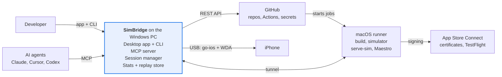
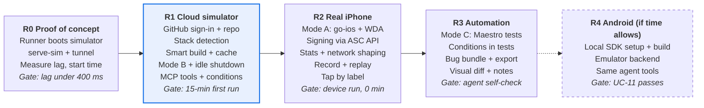

# SRS: iOS Agent Build Tool

Version 1.0 · 13 November 2026 · Author: Furqan

## 1. Introduction

SimBridge (working name) lets developers and AI agents build, run, test and debug Flutter and React Native iOS apps from a Windows PC, with no Mac on the desk. It uses GitHub Actions macOS runners for building and simulating, and a USB-connected iPhone for zero-cost testing.

### 1.1 Purpose

This document states what SimBridge must do and how well it must do it. It is the agreed baseline for the Software Design Specification (SDS), implementation and testing. Readers: the developer, project supervisor, evaluators, testers and future contributors.

### 1.2 Scope

In scope:

- Connecting a GitHub account, picking a repo and detecting its stack (Flutter, React Native, Expo)
- Smart iOS builds on GitHub macOS runners that skip work when nothing native changed
- Three run modes the user selects: real iPhone (Mode A), cloud simulator (Mode B), headless test (Mode C)
- An MCP server so AI agents (Claude, Cursor, Codex) can drive every feature
- Live stats, logs, crash reports and network inspection
- Recording, replaying and annotating user or agent sessions
- Device conditions: network speed, GPS location, push notifications, permissions
- Budget tracking for GitHub minutes, and safe handling of signing secrets
- Android emulator support in a later release, with the same agent tools

Out of scope:

- Running Xcode or macOS on Windows or Linux, and redistributing Xcode or the iOS SDK
- Replacing App Store Connect; SimBridge only uses its API
- Native Swift-only projects (served by xtool; possible future integration)

### 1.3 Definitions and abbreviations

| Term | Meaning |
| --- | --- |
| Runner | A GitHub-hosted macOS virtual machine that runs one workflow job |
| Session | One live Mode B run, from simulator boot to shutdown |
| Fingerprint | A hash of a project's native files, used to decide whether a rebuild is needed |
| Artifact | A build output saved by GitHub Actions (.app for simulator, .ipa for device) |
| MCP | Model Context Protocol: the standard way AI agents call external tools |
| WDA | WebDriverAgent: a helper app on the iPhone that accepts taps and swipes |
| go-ios | An open-source CLI that controls iPhones from Windows, Linux and macOS |
| serve-sim | An open-source tool that streams and controls the iOS Simulator in a browser |
| Maestro | An open-source mobile UI test runner that uses YAML test flows |
| Metro | The React Native JavaScript bundler that enables live reload |
| MJPEG | Motion JPEG: a simple video stream format browsers can show |
| ASC API | App Store Connect API: Apple's API for certificates, profiles and TestFlight |

### 1.4 References

- IEEE 830-1998 and ISO/IEC/IEEE 29148:2018 (structure of this SRS)
- [GitHub Actions billing](https://docs.github.com/en/billing/concepts/product-billing/github-actions) and [GitHub Terms for Additional Products](https://docs.github.com/en/site-policy/github-terms/github-terms-for-additional-products-and-features)
- [serve-sim](https://github.com/EvanBacon/serve-sim), [go-ios](https://pkg.go.dev/github.com/danielpaulus/go-ios@v1.0.70), [xtool](https://github.com/xtool-org/xtool)
- Project whiteboards: [first architecture](https://claude.ai/artifact/4D7ECuwbWonWeQbmFv6P48) and [full system design](https://claude.ai/artifact/8vApmz2r6ojLxGYNWcXEFG)

## 2. Overall description

SimBridge is a Windows desktop app plus an MCP server that orchestrates work the user's PC cannot do itself. Compiling and simulating run on GitHub macOS runners; device testing runs on a USB iPhone; signing and release go through Apple's API.

### 2.1 Product perspective

SimBridge is a new, self-contained product that sits on top of existing services and open-source tools:

- **GitHub** (OAuth, repos, Actions, artifacts, secrets) provides the Mac hardware and storage
- **Apple App Store Connect API** provides certificates, provisioning profiles and TestFlight
- **serve-sim** streams and controls the simulator on the runner
- **go-ios + WebDriverAgent** stream and control a real iPhone over USB
- **Maestro** runs scripted test flows in headless mode
- **Cloudflare quick tunnel (Tailscale may be added later as an option)** connects the runner to the Windows PC
- **AI agents** connect over MCP

*Figure 2.1: System context. SimBridge sits between the PC, GitHub, Apple and the iPhone.*

People and agents talk only to SimBridge; SimBridge drives GitHub, the runner, Apple and the iPhone on their behalf.

### 2.2 User classes

| User class | Who | Main goals | Technical level |
| --- | --- | --- | --- |
| Windows developer | Student or indie developer with no Mac | Build and see their iOS app; test on an iPhone | Medium |
| AI coding agent | Claude, Cursor, Codex via MCP | Build, run, tap, read stats, verify its own changes | Automated |
| Team member / reviewer | Teammate, supervisor, QA tester | Watch a shared replay or session; report bugs | Low to medium |
| Pitch or demo audience | Evaluators, investors | Understand the system at a glance | Non-technical |

### 2.3 Operating environment

- Client: Windows 10/11 (64-bit); Linux and macOS clients are a later goal
- Runtime: Node.js 18+ for the CLI and MCP server; Go binaries for go-ios
- Mode A: iPhone on iOS 16+ connected by USB; Apple device drivers installed on Windows
- Mode B and C: GitHub-hosted standard macOS runners with Xcode and simulators preinstalled
- Network: outbound HTTPS only; no inbound ports opened on the user's PC

### 2.4 Design and implementation constraints

- **Apple licensing:** Xcode and macOS run only on Apple hardware (GitHub's runners qualify). SimBridge never bundles or redistributes Xcode or the iOS SDK.
- **GitHub terms:** hosted runners may only be used for building and testing the project in the repo where the workflow runs. Each user runs SimBridge workflows in their own repo, on their own account.
- **Runner limits:** a hosted job runs at most 6 hours. Private repos consume macOS minutes at 10x; public repos on standard runners are free.
- **Signing:** device builds need the user's own Apple Developer account. Simulator builds need none.
- **Licence:** SimBridge is open source (MIT or Apache 2.0) and keeps the notices of the tools it reuses.

### 2.5 Assumptions and dependencies

- The user has a GitHub account and can grant SimBridge access to the chosen repo.
- GitHub keeps offering macOS runners with current Xcode versions.
- serve-sim, go-ios, WebDriverAgent and Maestro remain maintained and compatible with new iOS versions.
- A tunnel provider is reachable from both the runner and the user's network.
- For Mode A, the user owns an iPhone and an Apple Developer account.

## 3. Functional requirements

SimBridge has 15 modules and 133 functional requirements. Priority uses MoSCoW (Must, Should, Could); release R1 is the first version, R2 and R3 follow (section 7).

### 3.1 M1 Account and repo setup

| ID | Requirement | Priority | Release |
| --- | --- | --- | --- |
| FR-SET-01 | The system shall let the user sign in with GitHub through a GitHub App (device flow), with access only to the repos the user picks and only these permissions: Actions write, Checks read, Contents and Pull requests write, Workflows write, Secrets write (R2). | Must | R1 |
| FR-SET-02 | The system shall list the user's repositories and let them pick one, with search. | Must | R1 |
| FR-SET-03 | The system shall add its build and session workflow files to the chosen repo through a pull request, never a direct push. | Must | R1 |
| FR-SET-04 | The system shall store tokens in the Windows Credential Manager, never in plain files. | Must | R1 |
| FR-SET-05 | The system shall guide the user through signing setup and store certificates and the ASC API key as GitHub repository secrets. | Must | R2 |
| FR-SET-06 | The system shall warn when a repo is private and show its expected macOS minute cost. | Should | R1 |
| FR-SET-07 | The system shall support several linked repos and let the user switch between them. | Should | R2 |

### 3.2 M2 Stack detection

| ID | Requirement | Priority | Release |
| --- | --- | --- | --- |
| FR-STK-01 | The system shall detect Flutter (pubspec.yaml), React Native (package.json with react-native) and Expo (app.json or app.config with expo). | Must | R1 |
| FR-STK-02 | The system shall let the user override the detected stack. | Must | R1 |
| FR-STK-03 | The system shall detect the package manager (npm, yarn, pnpm, bun) and Flutter channel. | Should | R1 |
| FR-STK-04 | The system shall choose matching build commands per stack (flutter build ios; expo prebuild + xcodebuild; react-native xcodebuild). | Must | R1 |
| FR-STK-05 | The system shall report missing pieces (no ios folder, no bundle ID) with a fix suggestion. | Should | R1 |

### 3.3 M3 Smart build

| ID | Requirement | Priority | Release |
| --- | --- | --- | --- |
| FR-BLD-01 | The system shall compute a fingerprint of native inputs (Podfile.lock, pubspec.lock, ios folder, native dependencies, Xcode version). | Must | R1 |
| FR-BLD-02 | If the fingerprint matches a saved build, the system shall reuse it and start no build job. | Must | R1 |
| FR-BLD-03 | If the fingerprint differs, the system shall start a build job on a standard GitHub macOS runner. | Must | R1 |
| FR-BLD-04 | The build job shall cache CocoaPods, Pods and DerivedData between runs. | Should | R1 |
| FR-BLD-05 | The build job shall produce an unsigned simulator build (.app) without any Apple account. | Must | R1 |
| FR-BLD-06 | The build job shall produce a signed device build (.ipa) only when Mode A is enabled and signing is set up. | Must | R2 |
| FR-BLD-07 | The build job shall upload outputs as GitHub artifacts tagged with the fingerprint, then end immediately. | Must | R1 |
| FR-BLD-08 | The system shall stream build logs to the UI and agents, and summarise errors in plain words with the likely fix. | Must | R1 |
| FR-BLD-09 | The user shall be able to force a clean rebuild. | Should | R1 |

### 3.4 M4 Run mode selection

| ID | Requirement | Priority | Release |
| --- | --- | --- | --- |
| FR-MOD-01 | The system shall offer three run modes: A real iPhone, B cloud simulator, C headless test. | Must | R1 (B), R2 (A), R3 (C) |
| FR-MOD-02 | In auto mode, the system shall pick Mode A when a trusted iPhone is connected, else Mode B. | Should | R2 |
| FR-MOD-03 | The user or an agent shall be able to override the chosen mode. | Must | R2 |
| FR-MOD-04 | When remaining minutes fall below the budget threshold, the system shall suggest Mode A or C. | Should | R2 |

### 3.5 M5 Mode A: real iPhone

| ID | Requirement | Priority | Release |
| --- | --- | --- | --- |
| FR-DEV-01 | The system shall list USB-connected iPhones with name, model and iOS version. | Must | R2 |
| FR-DEV-02 | The system shall download the matching .ipa artifact and install it with go-ios. | Must | R2 |
| FR-DEV-03 | The system shall start WebDriverAgent on the device for taps, swipes, typing and hardware buttons. | Must | R2 |
| FR-DEV-04 | The system shall stream the device screen as MJPEG to the UI. | Must | R2 |
| FR-DEV-05 | For React Native, the system shall run Metro on Windows so the app reloads code over Wi-Fi without a rebuild. | Should | R2 |
| FR-DEV-06 | The system shall set up the iOS 17+ device tunnel automatically (including the Windows wintun driver). | Must | R2 |
| FR-DEV-07 | Mode A shall use no GitHub runner minutes after the build exists. | Must | R2 |

### 3.6 M6 Mode B: cloud simulator

| ID | Requirement | Priority | Release |
| --- | --- | --- | --- |
| FR-SIM-01 | The system shall start a session job that downloads the saved .app and does no compiling. | Must | R1 |
| FR-SIM-02 | The session job shall boot the chosen simulator model while the download runs. | Should | R1 |
| FR-SIM-03 | The session job shall install the app and start serve-sim. | Must | R1 |
| FR-SIM-04 | The session job shall open an outbound tunnel and report its URL and an access token to the client only. | Must | R1 |
| FR-SIM-05 | The client shall send a heartbeat every 30 seconds while a viewer or agent is active. | Must | R1 |
| FR-SIM-06 | The session shall end after N idle minutes without a heartbeat (default 10, configurable). | Must | R1 |
| FR-SIM-07 | The session shall end at a user-set hard cap (default 60 minutes), below GitHub's 6-hour job limit. | Must | R1 |
| FR-SIM-08 | The system shall reconnect to a live session instead of starting a second one. | Must | R1 |
| FR-SIM-09 | For React Native, Metro on Windows shall serve code to the simulator through the tunnel for live reload. | Should | R2 |
| FR-SIM-10 | For Flutter, the system shall sync changed Dart files to the runner and trigger hot reload. | Should (timeboxed spike) | R3 |
| FR-SIM-11 | The user shall be able to end a session at once from the UI, CLI or an agent tool. | Must | R1 |
| FR-SIM-12 | The runner-to-PC link shall go through a tunnel provider interface; the Cloudflare quick tunnel is the provider for R1, needing no account. | Must | R1 |
| FR-SIM-13 | Live logs, stats and control shall use WebSockets, never Server-Sent Events, so they work through quick tunnels. | Must | R1 |
| FR-SIM-14 | The UI and status tool shall show which tunnel is active, and suggest a fix when the tunnel drops repeatedly. | Should | R1 |
| FR-SIM-15 | The user may choose Tailscale as a private tunnel instead, per repo or per session; falling back to Cloudflare needs the user's consent. | Could | Later |

### 3.7 M7 Mode C: headless test

| ID | Requirement | Priority | Release |
| --- | --- | --- | --- |
| FR-HLT-01 | The system shall run a Maestro flow on a simulator in a short job with no live stream. | Must | R3 |
| FR-HLT-02 | The job shall capture screenshots per step, a video, logs and stats. | Must | R3 |
| FR-HLT-03 | The job shall return pass or fail, with the failing step, to the user or agent. | Must | R3 |
| FR-HLT-04 | The job shall save results as an artifact and end as soon as the flow finishes. | Must | R3 |
| FR-HLT-05 | The user may run a flow on several simulator models in parallel, with the minute cost shown first. | Could | R3 |

### 3.8 M8 Agent layer (MCP server)

| ID | Requirement | Priority | Release |
| --- | --- | --- | --- |
| FR-AGT-01 | The system shall run a local MCP server that Claude, Cursor and Codex can connect to, with one-click config. | Must | R1 |
| FR-AGT-02 | It shall expose run tools: build, run, switch_mode, end_session, status. | Must | R1 |
| FR-AGT-03 | It shall expose touch tools: tap, swipe, type_text, press_button, rotate. | Must | R1 |
| FR-AGT-04 | It shall expose see tools: screenshot and accessibility_tree. | Must | R1 |
| FR-AGT-05 | Agents shall be able to tap by accessibility label as well as by coordinates. | Should | R2 |
| FR-AGT-06 | It shall expose debug tools: logs, stats, crashes, network_requests. | Must | R2 |
| FR-AGT-07 | It shall expose replay tools: start_recording, stop_recording, replay, run_test, export_test. | Should | R2 |
| FR-AGT-08 | Every tool shall return structured JSON with clear errors and a suggested next action. | Must | R1 |
| FR-AGT-09 | Tools work the same in every mode, so an agent need not know which mode is active. | Must | R2 |
| FR-AGT-10 | The system shall support a self-check loop: edit, reload, run flow, read stats, report. | Should | R3 |
| FR-AGT-11 | Risky actions (forced rebuild, release upload, parallel runs) shall need user approval. | Must | R2 |

### 3.9 M9 Stats and debugging

| ID | Requirement | Priority | Release |
| --- | --- | --- | --- |
| FR-STA-01 | The system shall show live CPU and memory use of the app, with history over the session. | Must | R2 |
| FR-STA-02 | The system shall show frame rate and dropped frames. | Should | R2 |
| FR-STA-03 | The system shall list network requests with URL, status, size and timing. | Should | R2 |
| FR-STA-04 | The system shall stream console logs with filter and search. | Must | R1 |
| FR-STA-05 | The system shall capture crash reports and show symbolicated stack traces where possible. | Must | R2 |
| FR-STA-06 | The system shall record app launch time, build time and minutes used. | Should | R2 |
| FR-STA-07 | The system shall alert when memory or launch time crosses a user-set limit. | Could | R3 |

### 3.10 M10 Record and replay

| ID | Requirement | Priority | Release |
| --- | --- | --- | --- |
| FR-RPL-01 | The system shall record taps, swipes, typing and button presses with timestamps, from users and agents. | Must | R2 |
| FR-RPL-02 | Each step shall store a screenshot and a stats snapshot. | Must | R2 |
| FR-RPL-03 | The user shall scrub a timeline of steps and see the screen at each step. | Must | R2 |
| FR-RPL-04 | The system shall replay a recording on any mode and any later build. | Must | R2 |
| FR-RPL-05 | The system shall export a recording as a Maestro test flow. | Should | R3 |
| FR-RPL-06 | The system shall build a one-click bug bundle (replay, logs, stats, screenshot) and send it to an agent. | Should | R3 |
| FR-RPL-07 | The system shall compare screenshots of the same step across builds and highlight differences (visual diff). | Could | R3 |
| FR-RPL-08 | An agent shall write a short plain-language note for each replay step (annotated replay). | Could | R3 |
| FR-RPL-09 | The user shall share a replay through a private link. | Could | R3 |

### 3.11 M11 Device conditions

Device conditions are compulsory (Must): every run mode must reproduce real-world situations so bugs that only appear on a slow network, in another city, on a notification or after a denied permission are caught before users see them. Simulator support for location, push and permissions ships in R1 with Mode B; network shaping and real-iPhone support ship in R2.

#### 3.11.1 Network

| ID | Requirement | Priority | Release |
| --- | --- | --- | --- |
| FR-CND-01 | The system shall offer network profiles: Offline, Edge, 3G, LTE, Wi-Fi, Very bad network (high loss), and Custom. | Must | R2 |
| FR-CND-02 | A Custom profile shall set download and upload bandwidth (kbps), added latency (ms) and packet loss (%). | Must | R2 |
| FR-CND-03 | On the cloud simulator, shaping shall apply to the app's traffic but never to the stream tunnel or the runner's control traffic. | Must | R2 |
| FR-CND-04 | On a real iPhone, profiles shall use the device's built-in network conditioning through go-ios. | Must | R2 |
| FR-CND-05 | The user shall switch to Offline and back in one click, without restarting the app. | Must | R2 |

#### 3.11.2 Location (GPS)

| ID | Requirement | Priority | Release |
| --- | --- | --- | --- |
| FR-CND-06 | The system shall set a fixed location by latitude and longitude, or from a saved list of named places. | Must | R1 |
| FR-CND-07 | The system shall play a route from a GPX file or a list of points, at a chosen speed (walking, cycling, driving or a custom km/h). | Must | R1 |
| FR-CND-08 | Location and routes shall also work on a real iPhone (go-ios). | Must | R2 |
| FR-CND-09 | The user shall clear the simulated location and return to the default. | Must | R1 |

#### 3.11.3 Push notifications

| ID | Requirement | Priority | Release |
| --- | --- | --- | --- |
| FR-CND-10 | The system shall send a push notification to the app on the simulator, with title, body, badge, sound and custom data, from a form or raw JSON. | Must | R1 |
| FR-CND-11 | The system shall check a payload before sending: valid JSON, an aps section, and no more than 4 KB. | Must | R1 |
| FR-CND-12 | The user shall save payload templates per repo and reuse them. | Should | R1 |
| FR-CND-13 | The system shall send a push to a real iPhone through Apple's sandbox push service (APNs), using the user's own APNs auth key and the app's device token. | Should | R2 |

#### 3.11.4 Permissions

| ID | Requirement | Priority | Release |
| --- | --- | --- | --- |
| FR-CND-14 | On the simulator, the system shall grant, revoke or reset the app's access per service: location (when in use, always), photos, contacts, calendar, reminders, microphone, motion and media library. | Must | R1 |
| FR-CND-15 | The system shall answer system permission prompts automatically (Allow, Don't Allow) or leave them for the user, set per session or per test. | Must | R1 |
| FR-CND-16 | On a real iPhone, prompts shall be answered through WebDriverAgent, and permissions reset by reinstalling the app (iOS offers no direct grant on devices). | Must | R2 |

#### 3.11.5 Common to all conditions

| ID | Requirement | Priority | Release |
| --- | --- | --- | --- |
| FR-CND-17 | The UI shall show every active condition in a status strip above the device screen, with one-click removal. | Must | R1 |
| FR-CND-18 | The user shall save a combination of conditions as a named scenario (for example "Commuter on 3G with location denied") and apply it in one step. | Should | R2 |
| FR-CND-19 | All conditions shall be reset when a session ends, so the next session starts clean. | Must | R1 |
| FR-CND-20 | Conditions applied during a recording shall be stored as steps and re-applied on replay. | Must | R2 |
| FR-CND-21 | Every condition shall be available to agents as MCP tools that return the applied state. | Must | R1 |
| FR-CND-22 | A condition shall take effect within 3 seconds; a failure shall return the reason and leave the previous state in place. | Must | R1 |
| FR-CND-23 | Headless test flows shall set conditions before or between steps. | Must | R3 |

### 3.12 M12 Android support

Android is planned for release R4, after the iOS releases, and is built only if time allows. It reuses every agent tool, the recorder, stats and device conditions; only the setup, build and device backend are new. Everything runs on the Windows PC itself, so Android costs no GitHub minutes.

Why it is cheaper than iOS: Google's Android SDK, emulator and build tools run natively on Windows, so no cloud Mac, tunnel or signing account is needed for debug builds.

#### 3.12.1 Setup

| ID | Requirement | Priority | Release |
| --- | --- | --- | --- |
| FR-AND-01 | The system shall check the PC for Android needs: CPU virtualization on, Windows Hypervisor Platform or the Android Emulator hypervisor driver, free RAM and disk; and explain each fix in plain words. | Could | R4 |
| FR-AND-02 | The system shall find an existing Android SDK or install the command-line tools, platform-tools (adb), emulator and one system image, showing Google's licence prompts to the user. | Could | R4 |
| FR-AND-03 | The system shall create and manage emulators (AVDs) from presets: phone, small phone, tablet, and a chosen Android version. | Could | R4 |

#### 3.12.2 Build

| ID | Requirement | Priority | Release |
| --- | --- | --- | --- |
| FR-AND-04 | The system shall build a debug APK locally: Flutter with flutter build apk --debug; React Native and Expo with Gradle assembleDebug (after expo prebuild for Expo). | Could | R4 |
| FR-AND-05 | The system shall keep a separate Android fingerprint (gradle files, android folder, native dependencies) and skip the build when nothing native changed. | Could | R4 |
| FR-AND-06 | The user may build on a GitHub Linux runner instead (billed at 1x, not 10x) when the PC is too slow. | Could | R4 |

#### 3.12.3 Run and control

| ID | Requirement | Priority | Release |
| --- | --- | --- | --- |
| FR-AND-07 | The system shall boot an emulator (windowed or headless), install the APK with adb and launch the app. | Could | R4 |
| FR-AND-08 | The system shall stream the screen into the SimBridge viewer, with at least 25 fps as the target. | Could | R4 |
| FR-AND-09 | The system shall support tap, swipe, typing, the Back, Home and Recents buttons, and rotation. | Could | R4 |
| FR-AND-10 | The system shall read the accessibility tree (UI Automator) so agents can tap by label. | Could | R4 |
| FR-AND-11 | Live reload shall work: Metro reached through adb reverse for React Native, hot reload for Flutter. | Could | R4 |
| FR-AND-12 | The system shall also run on a real Android phone connected by USB, through adb. | Could | R4 |

#### 3.12.4 Insight and conditions

| ID | Requirement | Priority | Release |
| --- | --- | --- | --- |
| FR-AND-13 | The system shall stream logs (logcat, filtered to the app) and capture crashes and "app not responding" errors. | Could | R4 |
| FR-AND-14 | The system shall show CPU, memory, frame rate and dropped frames, using Android's own reporting tools. | Could | R4 |
| FR-AND-15 | Device conditions shall work on the emulator: network speed and delay, location and routes, permission grant and revoke, and push through Firebase Cloud Messaging with the user's own Firebase project (Should). | Could | R4 |
| FR-AND-16 | Recording, replay, Maestro tests, bug bundles and visual diff shall work with the same file formats as iOS. | Could | R4 |
| FR-AND-17 | MCP tools shall be identical for Android; status shall report the platform. | Could | R4 |

#### 3.12.5 Acceptance for R4

- A Flutter and a React Native sample app build, run, record, replay and pass a Maestro test on an emulator with 0 GitHub minutes used.
- An agent completes the self-check loop (UC-04) on Android with no change to its tool calls.
- A PC with 8 GB RAM and virtualization on runs the emulator and SimBridge together without failing NFR-PERF-07.

### 3.13 M13 Windows desktop app (UI)

| ID | Requirement | Priority | Release |
| --- | --- | --- | --- |
| FR-UI-01 | The app shall show the live device or simulator screen; a click is a tap, a drag is a swipe. | Must | R1 |
| FR-UI-02 | The app shall show session status, mode, elapsed time and idle countdown. | Must | R1 |
| FR-UI-03 | The app shall show stats panels (CPU, memory, FPS, network). | Must | R2 |
| FR-UI-04 | The app shall show a logs console and build logs. | Must | R1 |
| FR-UI-05 | The app shall show a replay timeline. | Must | R2 |
| FR-UI-06 | The app shall show minutes used this month, per repo. | Must | R1 |
| FR-UI-07 | The app shall offer a CLI with the same commands as the UI. | Must | R1 |

### 3.14 M14 Budget and safety

| ID | Requirement | Priority | Release |
| --- | --- | --- | --- |
| FR-BUD-01 | The system shall track macOS minutes used per repo and month. | Must | R1 |
| FR-BUD-02 | The system shall warn at a user-set share of the allowance (default 80%) and block new sessions at 100% unless the user confirms. | Must | R1 |
| FR-BUD-03 | Idle shutdown shall always be on and cannot be disabled, only lengthened up to the hard cap. | Must | R1 |
| FR-BUD-04 | Workflows shall only build and test the repo they live in. | Must | R1 |
| FR-BUD-05 | Signing secrets shall be read only inside device-build jobs and never logged. | Must | R2 |

### 3.15 M15 Release (optional)

| ID | Requirement | Priority | Release |
| --- | --- | --- | --- |
| FR-REL-01 | The system shall bump version and build numbers. | Could | R3 |
| FR-REL-02 | The system shall upload a signed build to TestFlight through the ASC API, after user approval. | Could | R3 |

## 4. External interface requirements

SimBridge talks to people through a desktop app and CLI, to agents through MCP, and to five outside systems through their public APIs or CLIs.

### 4.1 User interfaces

- **Desktop app (Windows):** a main window with the device screen on the left, and tabs on the right for Stats, Logs, Replay and Settings. A top bar shows repo, stack, mode, session timer and minutes used.
- **Setup wizard:** sign in to GitHub, pick repo, confirm stack, review workflow pull request, optional signing setup, connect agents.
- **CLI:** `simbridge login`, `init`, `build`, `up`, `down`, `status`, `logs`, `record`, `replay`, `test`. Every command takes `--json` for scripts.
- **Accessibility:** keyboard access to all actions; text contrast of at least 4.5:1; screen-reader labels on controls.

### 4.2 Agent interface (MCP)

- Transport: MCP over stdio for local agents; optional local HTTP (localhost only) for agents that need it.
- Tool groups: run, touch, see, debug, replay, conditions (section 3.8 lists them).
- Every result: JSON with `ok`, `data`, `error` (code, message, hint) and `next` (suggested next tool).
- Screenshots return as PNG images; the accessibility tree as JSON with labels, roles and frames.

### 4.3 Software interfaces

| System | Used for | Interface |
| --- | --- | --- |
| GitHub | Sign-in, repos, workflow dispatch, artifacts, secrets, usage | REST and GraphQL APIs, OAuth / GitHub App |
| GitHub Actions runner (macOS) | Build, simulator session, headless test | Workflow YAML; xcodebuild, simctl, flutter, expo CLIs |
| Apple App Store Connect | Certificates, profiles, devices, TestFlight | ASC REST API with API key (JWT) |
| serve-sim | Simulator stream and control on the runner | CLI + HTTP/MJPEG on the runner, reached through the tunnel |
| go-ios + WebDriverAgent | Install, stream, control, stats on a real iPhone | go-ios CLI (JSON output); WDA HTTP API |
| Maestro | Headless test flows | Maestro CLI and YAML flows |
| Tunnel (Cloudflare quick tunnel) | Runner to PC connection | cloudflared quick tunnel, outbound from the runner; HTTPS and WebSockets only (quick tunnels do not support SSE) |
| Metro (React Native) | Live reload | Metro dev server on Windows, reached by the app |
| Apple Push Notification service (APNs) | Test pushes to a real iPhone (FR-CND-13) | HTTP/2 API, sandbox host, token-based auth with the user's .p8 key |
| Android SDK: adb, emulator, Gradle (R4) | Android setup, build, run, control, stats, conditions | Command-line tools; emulator console; adb shell commands |
| Firebase Cloud Messaging (R4) | Test pushes to Android apps | FCM HTTP v1 API with the user's service account |

### 4.4 Hardware interfaces

- iPhone over USB (Lightning or USB-C), through Apple's usbmux service on Windows.
- No special hardware for Modes B and C.

### 4.5 Communication interfaces

- All traffic over HTTPS or WSS (TLS 1.2+).
- The tunnel is outbound from the runner; the user's PC opens no inbound port.
- Every session has a random access token; the stream and control endpoints reject requests without it.

## 5. Non-functional requirements

The targets below are starting values; the proof of concept (section 7) measures the real numbers and the team adjusts them before R1 is frozen.

### 5.1 Performance

| ID | Requirement | Target |
| --- | --- | --- |
| NFR-PERF-01 | Time from `up` to a usable simulator when a saved build exists | Under 3 minutes (95th percentile) |
| NFR-PERF-02 | Tap-to-screen-update latency in Mode B over the tunnel | Under 400 ms median |
| NFR-PERF-03 | Tap-to-screen-update latency in Mode A over USB | Under 150 ms median |
| NFR-PERF-04 | Stream frame rate | At least 15 fps in Mode B; 25 fps in Mode A |
| NFR-PERF-05 | Live reload of a JavaScript change (React Native) | Under 5 seconds |
| NFR-PERF-06 | MCP tool response for screenshot or tap | Under 1 second |
| NFR-PERF-07 | Desktop app memory use while streaming | Under 400 MB |

### 5.2 Cost efficiency

| ID | Requirement |
| --- | --- |
| NFR-COST-01 | A JavaScript-only change shall use 0 build minutes. |
| NFR-COST-02 | No runner shall stay alive more than the idle timeout after the last heartbeat (plus 1 minute for shutdown). |
| NFR-COST-03 | Build jobs shall end within 1 minute of uploading their artifact. |
| NFR-COST-04 | Only standard runners shall be used by default, so public repos cost nothing. |

### 5.3 Security and privacy

| ID | Requirement |
| --- | --- |
| NFR-SEC-01 | GitHub tokens stored only in the Windows Credential Manager; signing material only in GitHub secrets. |
| NFR-SEC-02 | Least-privilege GitHub scopes; a GitHub App with per-repo access (decided: no OAuth App, no broad repo scope). |
| NFR-SEC-03 | Session endpoints protected by a random token of at least 128 bits, valid for one session only. |
| NFR-SEC-04 | No secrets, tokens or personal data in logs, recordings or bug bundles; recordings mask typed passwords. |
| NFR-SEC-05 | Shared replay links are private by default and expire (default 7 days). |
| NFR-SEC-06 | No telemetry leaves the PC without opt-in. |

### 5.4 Reliability and availability

| ID | Requirement |
| --- | --- |
| NFR-REL-01 | If the tunnel drops, the client retries for 60 seconds before declaring the session lost. |
| NFR-REL-02 | A lost client never leaves a runner running: the runner's watchdog ends it independently. |
| NFR-REL-03 | A failed build leaves the last good build usable. |
| NFR-REL-04 | Recordings are saved incrementally so a crash loses at most the last step. |

### 5.5 Usability

| ID | Requirement |
| --- | --- |
| NFR-USE-01 | A new user goes from install to seeing their app in under 15 minutes, with no Mac knowledge. |
| NFR-USE-02 | Every error message says what happened, why, and what to do next, in plain words. |
| NFR-USE-03 | Agents can complete a build-run-screenshot loop with no human help after setup. |

### 5.6 Maintainability and portability

| ID | Requirement |
| --- | --- |
| NFR-MNT-01 | Each run mode is a plug-in backend behind one interface, so new backends (self-hosted Mac, Android) need no change to agent tools. |
| NFR-MNT-02 | Workflow templates are versioned; the app offers an update pull request when templates change. |
| NFR-MNT-03 | Core logic has automated tests with at least 70% line coverage. |
| NFR-POR-01 | The client runs on Windows 10/11 in R1 and is designed to build for Linux and macOS later. |

### 5.7 Legal and compliance

| ID | Requirement |
| --- | --- |
| NFR-LEG-01 | No Xcode, macOS or iOS SDK files are bundled, copied or redistributed. |
| NFR-LEG-02 | Workflows only build and test the repo they live in (GitHub terms). |
| NFR-LEG-03 | Licences of reused open-source tools are kept and listed in the app's About screen. |

## 6. Use cases

Eleven use cases cover the main journeys; UC-01 to UC-04 are the R1 core, and UC-11 (Android) belongs to R4.

| ID | Use case | Primary actor | Requirements |
| --- | --- | --- | --- |
| UC-01 | First-time setup | Windows developer | FR-SET-01 to 04, FR-STK-01 to 05 |
| UC-02 | Build the app | Developer or agent | FR-BLD-01 to 09 |
| UC-03 | Run in the cloud simulator | Developer or agent | FR-SIM-01 to 15, FR-UI-01 to 02 |
| UC-04 | Agent verifies its own change | AI agent | FR-AGT-01 to 10 |
| UC-05 | Test on a real iPhone | Developer | FR-DEV-01 to 07 |
| UC-06 | Run a headless test | Agent or CI | FR-HLT-01 to 05 |
| UC-07 | Debug a performance problem | Developer | FR-STA-01 to 07 |
| UC-08 | Record, replay and report a bug | Developer, reviewer | FR-RPL-01 to 09 |
| UC-09 | Test under device conditions | Developer or agent | FR-CND-01 to 23 |
| UC-10 | Stay within the minute budget | Developer | FR-BUD-01 to 05 |
| UC-11 | Run and test on Android (R4) | Developer or agent | FR-AND-01 to 17 |

### UC-01 First-time setup

- **Precondition:** SimBridge is installed; the user has a GitHub account.
- **Main flow:**
  1. The user signs in with GitHub.
  2. The user picks a repo; the system detects the stack and shows it.
  3. The user confirms or changes the stack.
  4. The system opens a pull request adding the workflow files; the user merges it.
  5. The system offers to connect agents and writes their MCP config.
- **Alternative:** no ios folder in an Expo project; the system explains that prebuild will create it during the build.
- **Postcondition:** the repo is linked and ready to build.

### UC-02 Build the app

- **Main flow:**
  1. The user or agent runs build.
  2. The system computes the fingerprint.
  3. If a saved build matches, the system reports "reusing build" and stops (0 minutes).
  4. Otherwise it starts the build job and streams logs.
  5. The job saves the .app (and .ipa if Mode A is enabled) and ends.
- **Exception:** the build fails; the system shows the error summary and likely fix, and keeps the last good build.

### UC-03 Run in the cloud simulator

- **Main flow:**
  1. The user runs up (or picks Mode B).
  2. The system reconnects if a session is live; otherwise it starts a session job.
  3. The runner downloads the build, boots the simulator, installs the app, starts serve-sim and opens the tunnel.
  4. The client shows the screen; clicks become taps.
  5. The client sends heartbeats; the user works.
  6. The user runs down, or the idle timeout or hard cap ends the session.
- **Exception:** the tunnel drops; the client retries for 60 seconds, then reports the session lost while the runner's watchdog ends the job.

### UC-04 Agent verifies its own change

- **Main flow:**
  1. The agent edits code in the repo.
  2. The agent calls build; the system reuses or rebuilds.
  3. The agent calls run, then reads the accessibility tree and taps by label.
  4. The agent takes screenshots and reads logs and stats.
  5. If something is wrong, the agent fixes the code and repeats; if right, it reports success with screenshots.
- **Rule:** risky actions (forced rebuild, parallel runs, release) wait for user approval.

### UC-05 Test on a real iPhone

- **Precondition:** iPhone connected and trusted; signing set up.
- **Main flow:** the system downloads the .ipa, installs it with go-ios, starts WebDriverAgent and streams the screen; Metro on Windows serves live code for React Native.
- **Postcondition:** no runner minutes used.

### UC-06 Run a headless test

- **Main flow:** the agent calls run_test with a Maestro flow; a short job runs it on a simulator; the agent gets pass or fail, the failing step, screenshots, video and logs; the job ends.

### UC-07 Debug a performance problem

- **Main flow:** the user opens the Stats tab during a session, sees memory climbing on one screen, opens network requests and logs for that time, and saves a snapshot to the replay.

### UC-08 Record, replay and report a bug

- **Main flow:** the user starts recording, reproduces a bug, stops recording, then clicks "Send to agent". The system builds the bug bundle; the agent replays it on the next build to confirm the fix. Optionally the agent annotates each step and the user shares a private link.

### UC-09 Test under device conditions

- **Precondition:** a live session in any mode; for a real-iPhone push, the user has added their APNs key.
- **Main flow:**
  1. The user opens the Conditions panel (or an agent calls the condition tools).
  2. The user picks the 3G profile; the status strip shows "3G" within 3 seconds.
  3. The user sets the location to a saved place, then plays a GPX route at driving speed.
  4. The user sends a test push from a saved template; the notification appears on the screen.
  5. The user revokes photo access; the app shows its fallback screen.
  6. The user saves the set as the scenario "Commuter on 3G" for next time.
  7. When the session ends, every condition is reset.
- **Alternative A (agent):** the agent applies the scenario, taps through the flow, reads logs, and reports any screen that breaks on slow network.
- **Alternative B (recording):** conditions set while recording are saved as steps and re-applied on replay.
- **Exception:** a condition cannot be applied (for example, push to a real iPhone without an APNs key); the system says why and keeps the previous state.

### UC-10 Stay within the minute budget

- **Main flow:** the system shows minutes used; at 80% it warns and suggests Mode A or headless tests; at 100% it blocks new sessions until the user confirms.

### UC-11 Run and test on Android (R4)

- **Precondition:** virtualization is on; the Android SDK is installed by SimBridge or found on the PC.
- **Main flow:**
  1. The user picks Android for the linked repo; the system checks the PC and fixes or explains any gap.
  2. The system builds a debug APK locally, or reuses one if the Android fingerprint matches.
  3. The system boots an emulator, installs and launches the app, and streams it into the same viewer.
  4. The user or agent uses the same tools: tap by label, screenshots, logs, stats, conditions, record and replay.
- **Postcondition:** no GitHub minutes used.

## 7. Release plan and traceability

Work ships in four phases, and each one starts only when the previous gate passes. R1 is the first version people can use.

*Figure 7.1: Release roadmap. Each release adds a run mode; the proof of concept gates everything.*

The proof of concept comes first because stream lag through a tunnel is the one thing that could sink the idea. Every requirement in section 3 carries its release (R1, R2, R3), and section 6 maps each use case to its requirements.

### 7.1 Acceptance per release

- [ ] **R0:** a workflow boots a simulator, starts serve-sim, opens a tunnel and prints the URL; tap lag measured on a Windows PC; the MJPEG stream and a WebSocket log stream confirmed working through the Cloudflare quick tunnel.
- [ ] **R1:** UC-01 to UC-04, plus UC-09 on the simulator, pass end to end on one Flutter and one React Native sample app; no runner outlives its idle timeout in 20 test sessions.
- [ ] **R2:** UC-05, UC-07 and UC-08 pass on a real iPhone with 0 runner minutes after the build.
- [ ] **R3:** UC-06 passes with conditions set inside test flows; an agent fixes a seeded bug using only the bug bundle.

### 7.2 Open questions

- **Still open:** final product name (SimBridge is a working name).
- **Decided (14 Nov 2026), tunnel:** Cloudflare quick tunnel for now, behind a tunnel provider interface; Tailscale may be added later as an option (FR-SIM-12 to 15).
- **Decided, streaming:** WebSockets instead of Server-Sent Events, because quick tunnels do not support SSE (FR-SIM-13).
- **Decided, sign-in:** GitHub App with device flow and per-repo access, not an OAuth App (FR-SET-01).
- **Decided, Flutter hot reload:** feasible; FR-SIM-10 becomes Should, starting R3 with a timeboxed spike, with rebuild as the fallback.
